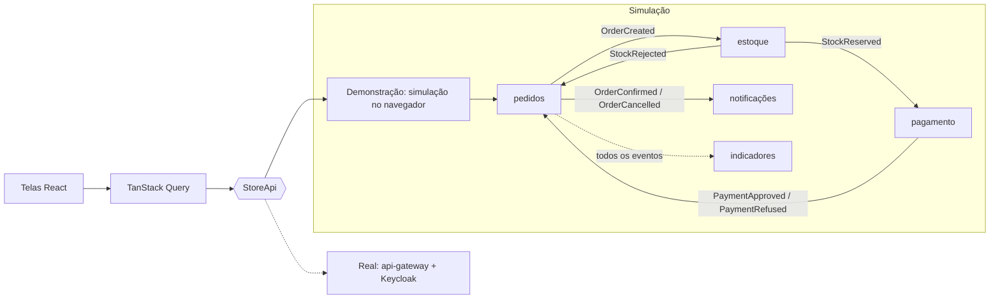

# order-dashboard

[](https://github.com/Jhonatas-de-Freitas/order-dashboard/actions/workflows/ci.yml)

## O que é

O painel web de uma loja fictícia. Nele eu faço um pedido e acompanho o que acontece depois: o estoque é reservado, o pagamento é cobrado e o pedido é confirmado ou cancelado. A tela muda sozinha, sem recarregar.

É a parte visível de um sistema com mais quatro repositórios (`order-platform`, `api-gateway`, `notification-service` e `order-analytics`). Para ninguém precisar subir tudo isso só para olhar, o painel tem um modo demonstração: um backend simulado roda dentro do navegador e segue as mesmas regras do sistema de verdade.

Telas:

- **Loja**: catálogo, carrinho e finalizar pedido.
- **Pedidos**: lista com o estado de cada pedido, ao vivo, com filtro por estado.
- **Detalhe do pedido**: linha do tempo, itens, pagamento e notificações enviadas.
- **Indicadores** (admin): totais, faturamento por dia, pedidos por estado, motivos de cancelamento e produtos mais vendidos.
- **Estoque** (admin): ajuste do saldo de cada produto.

## Como funciona

As telas não sabem de onde vêm os dados. Elas falam com uma interface só, `StoreApi` (`src/api/store-api.ts`), e quem responde é escolhido na partida.



Na simulação (`src/api/demo`), cada serviço tem as suas tabelas e só conversa com os outros por eventos, com o mesmo formato e os mesmos nomes do contrato do sistema. Cada reação é uma tarefa com hora marcada. Isso dá três coisas com o mesmo código:

- o pedido anda ao vivo, em alguns segundos, por temporizador;
- se eu recarrego a página no meio, o que estava pendente continua de onde parou (o estado fica no `sessionStorage`);
- o histórico de 14 dias que aparece na primeira visita é montado passando pedidos antigos pelas mesmas regras, então os indicadores são calculados, não são números fixos.

Quando o estado de um pedido muda, o painel recebe um aviso, busca de novo o que está na tela e anuncia a mudança para leitores de tela. Se o aviso parar de chegar, as listas passam a consultar a cada 5 segundos.

O modo real (falar com o `api-gateway` e fazer login no Keycloak) ainda não está neste repositório. A interface já foi desenhada para ele: os tipos em `src/api/types.ts` são os do contrato.

## Como rodar

Precisa de Node 22 ou mais novo.

```bash
npm install
npm run dev
```

Abre em `http://localhost:5173`, já no modo demonstração. Não precisa de mais nada rodando.

Para ver a versão de produção:

```bash
npm run build
npm run preview
```

## Como testar os cenários

No topo da página dá para trocar entre **Ana (cliente)** e **Admin**, sem senha. **Recomeçar** apaga o que eu fiz e volta ao ponto de partida.

1. **Pedido confirmado.** Na Loja, some um Teclado Mecânico e finalize. Em Pedidos, a linha nova aparece como "Recebido", passa por "Estoque reservado" e termina "Confirmado".
2. **Sem estoque.** Peça um Headset USB (saldo zero). Termina "Cancelado", com o motivo "sem estoque" no detalhe.
3. **Pagamento recusado.** Peça um Notebook Pro 16 (R$ 7.499,00, acima do limite de R$ 5.000,00). O estoque é reservado, o pagamento é recusado e o estoque volta.
4. **Detalhe.** Abra qualquer pedido: linha do tempo, pagamento e as notificações por e-mail e push.
5. **Acesso.** Como Ana, Indicadores e Estoque somem do menu, e abrir `/indicadores` direto mostra "Sem acesso". Como Admin, aparecem.
6. **Ajuste de saldo.** Como Admin, em Estoque, mude o saldo do Headset para 5 e peça de novo: agora confirma.
7. **Indicadores.** Como Admin, veja os números antes e depois de fazer pedidos.

Os testes automáticos cobrem os mesmos cenários:

```bash
npm run lint          # ESLint
npm run typecheck     # tsc
npm test              # Vitest: regras da simulação e telas
npx playwright install chromium
npm run build && npm run test:e2e   # Playwright no build de produção
```

O Playwright também passa o axe nas telas principais (tema claro e escuro) e confere que nada rola para o lado em 360 px e em 1440 px.

## Decisões que tomei e por quê

- **Uma interface para os dados, e a simulação atrás dela.** As telas, os testes de tela e o modo real usam o mesmo `StoreApi`. Nos testes de tela eu troco por um objeto simples e consigo provocar erro `429` ou `503` sem malabarismo.
- **Simular os serviços, não as respostas.** Seria mais rápido devolver JSON pronto com um `setTimeout`. Preferi reproduzir a coreografia por eventos, porque é ela que eu quero mostrar: reserva tudo ou nada, evento repetido ignorado, pagamento que chega antes da reserva, estoque devolvido no cancelamento.
- **Tempo lógico nas tarefas.** Cada reação guarda a hora em que deveria acontecer. Por isso recarregar a página não perde o pedido, e o histórico inicial é gerado em milissegundos com as mesmas funções.
- **As regras do gateway valem na demonstração.** Sem login responde `401`, cliente pedindo indicador responde `403`, e há limite de pedidos por segundo (`429`). Assim as telas de erro são exercitadas de verdade.
- **A lista não tenta adivinhar o estado.** O aviso ao vivo só dispara uma nova busca. É uma requisição a mais, mas a tela nunca mostra algo que o servidor não disse.
- **Cor só para o estado do pedido.** O resto da interface é tinta sobre papel. Azul, âmbar, verde e vermelho aparecem apenas para dizer em que ponto o pedido está, sempre com ícone e texto junto.
- **Uma família de fonte em três larguras** (Archivo variável): larga para títulos e valores, estreita para rótulos, normal para leitura. A fonte vai junto no build, sem pedir nada a outro servidor.
- **O gráfico só é baixado por quem abre Indicadores.** A biblioteca de gráficos é a maior parte do pacote e só o admin usa.

## O que eu faria a seguir

- O modo real: cliente HTTP com token e renovação, login com PKCE no Keycloak e SSE por `fetch`.
- Imagem Docker com nginx e publicação no GitHub Pages.
- Capturas de tela aqui no README e a medição do Lighthouse.
- Exportar os pedidos em CSV na tela de Indicadores.
