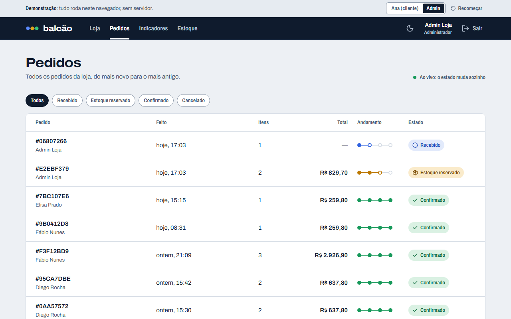
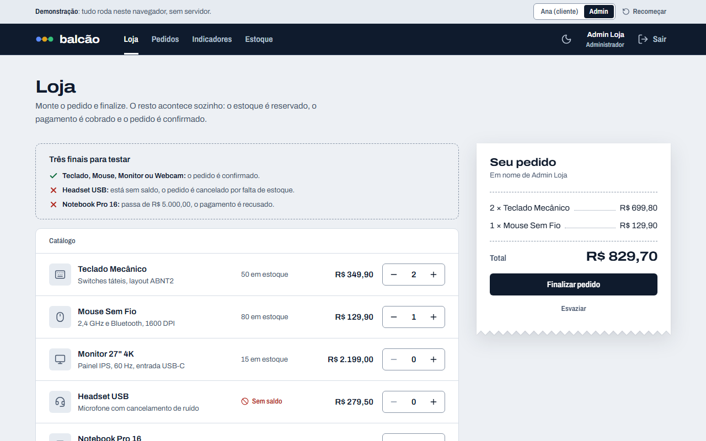
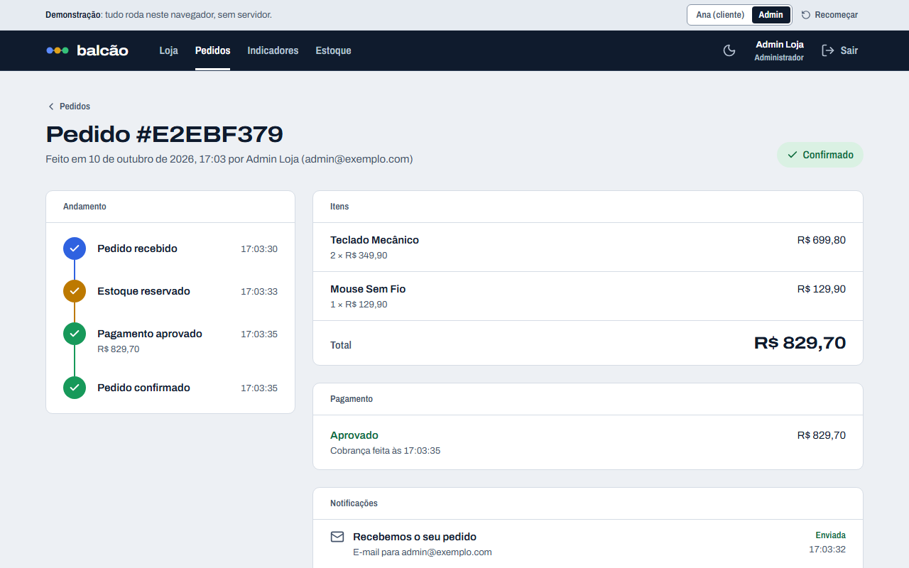
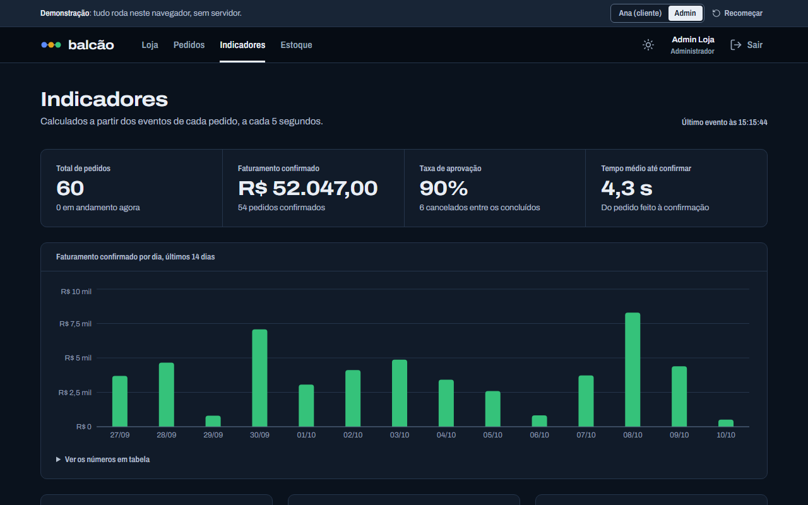
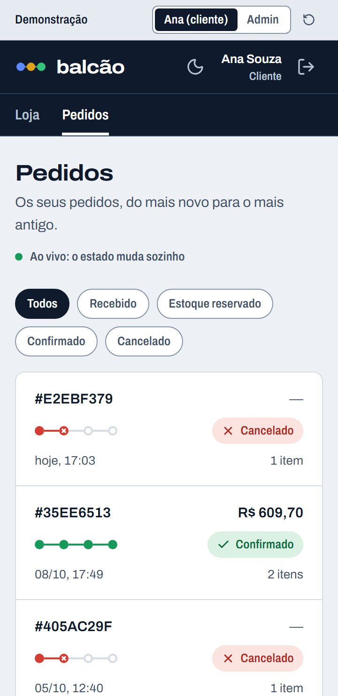
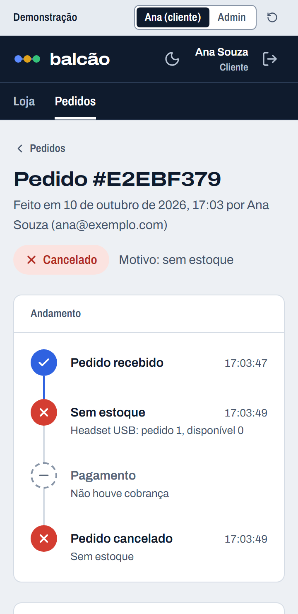
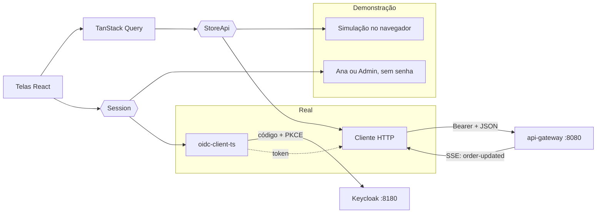

# order-dashboard

[](https://github.com/Jhonatas-de-Freitas/order-dashboard/actions/workflows/ci.yml)

## O que é

O painel web de uma loja fictícia. Nele eu faço um pedido e acompanho o que acontece depois: o estoque é reservado, o pagamento é cobrado e o pedido é confirmado ou cancelado. A tela muda sozinha, sem recarregar.

É a parte visível de um sistema com mais quatro repositórios: [order-platform](https://github.com/Jhonatas-de-Freitas/order-platform), [api-gateway](https://github.com/Jhonatas-de-Freitas/api-gateway), [notification-service](https://github.com/Jhonatas-de-Freitas/notification-service) e [order-analytics](https://github.com/Jhonatas-de-Freitas/order-analytics). Para ninguém precisar subir tudo isso só para olhar, o painel tem dois modos:

- **Demonstração** (o padrão): um backend simulado roda dentro do navegador e segue as mesmas regras do sistema de verdade.
- **Real**: fala com o `api-gateway` e faz login no Keycloak.

Endereço da demonstração: https://jhonatas-de-freitas.github.io/order-dashboard/ (quem publica é o job `deploy` do CI, a cada push na `main`).



| Loja                                                    | Detalhe do pedido                                                                                                                                                                       |
| ------------------------------------------------------- | --------------------------------------------------------------------------------------------------------------------------------------------------------------------------------------- |
|  |                                                                                                                      |
| **Indicadores, no tema escuro**                         | **No celular**                                                                                                                                                                          |
|   |   |

Telas: **Loja** (catálogo, carrinho e finalizar), **Pedidos** (lista ao vivo, com filtro por estado), **Detalhe do pedido** (linha do tempo, itens, pagamento e notificações) e, para quem é admin, **Indicadores** e **Estoque**.

## Como funciona

As telas não sabem de onde vêm os dados. Elas falam com uma interface só, `StoreApi` (`src/api/store-api.ts`), e com uma `Session` que diz quem está logado. Quem responde é escolhido na partida (`src/main.tsx`).



**Na demonstração** (`src/api/demo`), cada serviço tem as suas tabelas e só conversa com os outros por eventos, com os mesmos nomes e campos do sistema de verdade. Cada reação é uma tarefa com hora marcada. Com isso o pedido anda ao vivo, continua de onde parou se eu recarrego a página, e o histórico de 14 dias da primeira visita é gerado passando pedidos antigos pelas mesmas regras. Os indicadores são calculados, não são números fixos.

**No modo real** (`src/api/gateway` e `src/auth/oidc-session.ts`):

- O login é no Keycloak, com código de autorização e PKCE. Depois do login a pessoa volta para o endereço que tinha pedido.
- Toda chamada leva o token. Se ele venceu, é renovado antes. Se o gateway responde `401`, o painel renova uma vez e repete a chamada; se não der, encerra a sessão e volta para a tela de entrada.
- `403`, `429` e `503` chegam como erro com o corpo `problem+json` do gateway, e cada tela mostra o aviso certo com o botão de tentar de novo.
- A lista ao vivo lê `GET /api/orders/stream` com `fetch`, porque o `EventSource` do navegador não deixa mandar o cabeçalho `Authorization`. Se a conexão cai ou fica muda por 45 segundos, o painel avisa, passa a consultar a cada 5 segundos e tenta reconectar com intervalos crescentes.
- O `customerId` de quem está logado é o `sub` do token (um UUID que o Keycloak gera). Um pedido criado por `curl` com `c-1001`, como nos exemplos dos outros repositórios, não aparece na lista da Ana; só o admin vê.

## Como rodar

Precisa de Node 22.22 ou mais novo, menos o 23 e o 25, que o Vitest não aceita (o CI e a imagem usam o 24).

```bash
npm install
npm run dev
```

Abre em `http://localhost:5173`, já na demonstração. Não precisa de mais nada rodando.

**Modo real.** Precisa do `api-gateway` em `localhost:8080` e do Keycloak em `localhost:8180` (o `docker compose` do api-gateway sobe os dois; o sistema completo fica na pasta `full-stack` do order-platform). Copie `.env.example` para `.env`, troque para `VITE_DEMO_MODE=false` e rode `npm run dev`. Usuários: `ana` / `demo123` (cliente) e `admin` / `admin123`.

**Docker.** A imagem serve o build com nginx na porta 5173.

```bash
docker compose up --build
```

As variáveis são lidas quando o container sobe, então a mesma imagem serve em qualquer ambiente:

```bash
docker run --rm -p 5173:5173 \
  -e VITE_DEMO_MODE=false \
  -e VITE_API_URL=http://localhost:8080 \
  -e VITE_KEYCLOAK_URL=http://localhost:8180 \
  ghcr.io/jhonatas-de-freitas/order-dashboard
```

| Variável                  | Padrão                  | Para quê                                                                |
| ------------------------- | ----------------------- | ----------------------------------------------------------------------- |
| `VITE_DEMO_MODE`          | `true`                  | `false` liga o modo real                                                |
| `VITE_API_URL`            | `http://localhost:8080` | endereço do api-gateway, visto do navegador                             |
| `VITE_KEYCLOAK_URL`       | `http://localhost:8180` | endereço do Keycloak, visto do navegador                                |
| `VITE_KEYCLOAK_REALM`     | `store`                 | realm                                                                   |
| `VITE_KEYCLOAK_CLIENT_ID` | `store-web`             | cliente público, com `http://localhost:5173/*` como endereço de retorno |

## Como testar os cenários

Na demonstração, no topo da página dá para trocar entre **Ana (cliente)** e **Admin**. **Recomeçar** volta ao ponto de partida.

1. **Pedido confirmado.** Na Loja, some um Teclado Mecânico e finalize. Em Pedidos, a linha nova aparece como "Recebido", passa por "Estoque reservado" e termina "Confirmado".
2. **Sem estoque.** Peça um Headset USB (saldo zero). Termina "Cancelado", com o motivo "sem estoque" no detalhe.
3. **Pagamento recusado.** Peça um Notebook Pro 16 (R$ 7.499,00, acima do limite de R$ 5.000,00). O estoque é reservado, o pagamento é recusado e o estoque volta.
4. **Detalhe.** Abra qualquer pedido: linha do tempo, pagamento e as notificações por e-mail e push.
5. **Acesso.** Como Ana, Indicadores e Estoque somem do menu, e abrir `/indicadores` direto mostra "Sem acesso". Como Admin, aparecem.
6. **Ajuste de saldo.** Como Admin, em Estoque, mude o saldo do Headset para 5 e peça de novo: agora confirma.
7. **Indicadores.** Como Admin, veja os números antes e depois de fazer pedidos.

Com o container no ar, dá para conferir pelo terminal o que o nginx entrega:

```bash
curl -s http://localhost:5173/config.js            # as variáveis que o container recebeu
curl -s -o /dev/null -w '%{http_code}\n' http://localhost:5173/pedidos/qualquer-id   # 200: rota interna devolve o app
curl -s -o /dev/null -w '%{http_code}\n' http://localhost:5173/assets/nao-existe.js  # 404
```

Os testes automáticos:

```bash
npm run lint && npm run typecheck
npm test                                  # Vitest: simulação, telas e cliente do gateway
npx playwright install chromium
npm run build && npm run build:pages
npm run test:e2e                          # Playwright no build de produção
```

- **Vitest** cobre as regras da simulação, os estados de carregando, vazio e erro de cada tela, e o cliente do gateway contra respostas simuladas com MSW no formato do contrato (`401` com renovação, `403`, `429`, `503`, e o SSE cortado no meio de um caractere).
- **Playwright** cobre os cenários acima no build de produção, passa o axe nas telas (tema claro e escuro) e confere 360, 768, 1024 e 1440 px sem rolagem lateral.
- **Modo real no Playwright**: o mesmo build, com Keycloak e gateway simulados na rede. O teste só entrega o token se o verificador do PKCE bater com o desafio.
- **GitHub Pages**: o build com `/order-dashboard/` roda atrás de um servidor que responde como o Pages (`404.html` para rota interna).
- **Imagem**: o CI constrói, sobe o container com variáveis diferentes do padrão e confere o `config.js`, a rota interna e os cabeçalhos.

**Lighthouse.** Medi com o Lighthouse 13.5 no build de produção servido por `npm run preview`, na minha máquina, três vezes seguidas, em 10/10/2026. No perfil de celular (4G lento e CPU 4 vezes mais lenta, simulados): desempenho 97, 96 e 97, acessibilidade 100, boas práticas 100. No perfil de desktop: 100, 100 e 100.

## Decisões que tomei e por quê

- **Uma interface para os dados, com a simulação e o gateway atrás dela.** As telas e os testes de tela usam o mesmo `StoreApi`. Nos testes eu troco por um objeto simples e provoco `429` ou `503` sem malabarismo.
- **Simular os serviços, não as respostas.** Seria mais rápido devolver JSON pronto com um `setTimeout`. Preferi reproduzir a coreografia por eventos, porque é ela que eu quero mostrar: reserva tudo ou nada, evento repetido ignorado, pagamento que chega antes da reserva, estoque devolvido no cancelamento.
- **A lista não tenta adivinhar o estado.** O aviso ao vivo só dispara uma nova busca. É uma requisição a mais, mas a tela nunca mostra algo que o servidor não disse.
- **Sessão fora do React.** O cliente HTTP precisa do token e as telas precisam do usuário. Uma `Session` simples atende os dois, e o `oidc-client-ts` basta: não usei o `react-oidc-context`.
- **Papéis lidos do token de acesso.** O Keycloak põe os papéis do realm no token de acesso, não no de identidade. O painel lê ali só para montar o menu; quem decide o acesso é o gateway.
- **Token no `sessionStorage`.** Vale para a aba e some quando ela fecha. É o meio-termo entre pedir login a cada recarga e deixar o token guardado para sempre.
- **Configuração em `config.js`, não dentro do pacote.** O nginx responde esse arquivo com as variáveis do container. Se fossem trocadas no build, cada ambiente precisaria de uma imagem.
- **Rotas com endereço limpo no GitHub Pages.** O Pages não reescreve rotas, então o `404.html` é uma cópia do app. A rota interna abre e recarrega, mas a primeira resposta sai com status 404. Para uma demonstração eu aceito; com `#` no endereço não aconteceria.
- **Cor só para o estado do pedido.** O resto é tinta sobre papel. Azul, âmbar, verde e vermelho dizem em que ponto o pedido está, sempre com ícone e texto junto.
- **Faturamento por dia no calendário de quem olha.** O order-analytics agrupa por dia UTC, e no Brasil uma venda depois das 21h cairia na barra do dia seguinte, diferente da hora que a lista mostra. O painel pede o faturamento por hora e soma os dias no navegador.
- **O gráfico só é baixado por quem abre Indicadores**, e a biblioteca de login só no modo real.

## O que eu faria a seguir

- Rodar o Playwright do modo real contra o sistema completo no CI do order-platform, em vez de só contra a rede simulada.
- Cabeçalho `Content-Security-Policy` no nginx, montado com os endereços do gateway e do Keycloak.
- Trocar as consultas periódicas do detalhe (notificações) e dos indicadores por um stream, quando esses serviços tiverem um.
- O gateway aceita qualquer `customerId` na listagem. O filtro por cliente devia sair do token, no servidor.
- Exportar os pedidos em CSV na tela de Indicadores.
